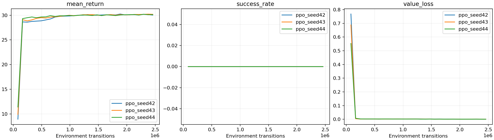

# Автоматически измеренные результаты

Это техническое приложение, построенное из файлов запусков. Автор отчётов: Daria Galushko, AI-01.

Обучающие seed представлены отдельно. Оценка использует другие случайные ключи; карта 0 — обучающая, карты 1 и 2 — перенос без дообучения. Доверительный интервал Wilson отражает вариативность эпизодов, а не независимых обучений.

## ppo_seed42

Обучение: завершено. Зафиксировано 2,457,600 переходов за 174.5 с (включая компиляцию), 14087 переходов/с.

| Карта | Политика | Эпизоды | Успех | Wilson 95% | Столкновения | Таймаут | Награда |
|---|---|---:|---:|---|---:|---:|---:|
| 0 | random | 32 | 0.0% | 0.0%–10.7% | 100.0% | 0.0% | -6.35 |
| 0 | heuristic | 32 | 100.0% | 89.3%–100.0% | 0.0% | 0.0% | 33.23 |
| 0 | untrained | 32 | 0.0% | 0.0%–10.7% | 0.0% | 100.0% | 33.08 |
| 0 | ppo | 32 | 0.0% | 0.0%–10.7% | 0.0% | 100.0% | 32.13 |
| 1 | random | 32 | 0.0% | 0.0%–10.7% | 100.0% | 0.0% | -6.35 |
| 1 | heuristic | 32 | 100.0% | 89.3%–100.0% | 0.0% | 0.0% | 33.23 |
| 1 | untrained | 32 | 0.0% | 0.0%–10.7% | 0.0% | 100.0% | 33.08 |
| 1 | ppo | 32 | 0.0% | 0.0%–10.7% | 0.0% | 100.0% | 32.13 |
| 2 | random | 32 | 0.0% | 0.0%–10.7% | 93.8% | 6.2% | -2.35 |
| 2 | heuristic | 32 | 0.0% | 0.0%–10.7% | 100.0% | 0.0% | -11.34 |
| 2 | untrained | 32 | 0.0% | 0.0%–10.7% | 100.0% | 0.0% | 10.87 |
| 2 | ppo | 32 | 0.0% | 0.0%–10.7% | 100.0% | 0.0% | 9.34 |

Видео фактических траекторий: [ppo_seed42/evaluation](ppo_seed42/evaluation). В видео всегда показан первый оценочный эпизод; успешные эпизоды специально не отбираются.

## ppo_seed43

Обучение: завершено. Зафиксировано 2,457,600 переходов за 174.2 с (включая компиляцию), 14107 переходов/с.

| Карта | Политика | Эпизоды | Успех | Wilson 95% | Столкновения | Таймаут | Награда |
|---|---|---:|---:|---|---:|---:|---:|
| 0 | random | 32 | 0.0% | 0.0%–10.7% | 100.0% | 0.0% | -6.35 |
| 0 | heuristic | 32 | 100.0% | 89.3%–100.0% | 0.0% | 0.0% | 33.23 |
| 0 | untrained | 32 | 0.0% | 0.0%–10.7% | 0.0% | 100.0% | 30.67 |
| 0 | ppo | 32 | 0.0% | 0.0%–10.7% | 0.0% | 100.0% | 31.95 |
| 1 | random | 32 | 0.0% | 0.0%–10.7% | 100.0% | 0.0% | -6.35 |
| 1 | heuristic | 32 | 100.0% | 89.3%–100.0% | 0.0% | 0.0% | 33.23 |
| 1 | untrained | 32 | 0.0% | 0.0%–10.7% | 0.0% | 100.0% | 30.67 |
| 1 | ppo | 32 | 0.0% | 0.0%–10.7% | 0.0% | 100.0% | 31.95 |
| 2 | random | 32 | 0.0% | 0.0%–10.7% | 93.8% | 6.2% | -2.35 |
| 2 | heuristic | 32 | 0.0% | 0.0%–10.7% | 100.0% | 0.0% | -11.34 |
| 2 | untrained | 32 | 0.0% | 0.0%–10.7% | 100.0% | 0.0% | 10.87 |
| 2 | ppo | 32 | 0.0% | 0.0%–10.7% | 100.0% | 0.0% | 9.46 |

Видео фактических траекторий: [ppo_seed43/evaluation](ppo_seed43/evaluation). В видео всегда показан первый оценочный эпизод; успешные эпизоды специально не отбираются.

## ppo_seed44

Обучение: завершено. Зафиксировано 2,457,600 переходов за 168.0 с (включая компиляцию), 14629 переходов/с.

| Карта | Политика | Эпизоды | Успех | Wilson 95% | Столкновения | Таймаут | Награда |
|---|---|---:|---:|---|---:|---:|---:|
| 0 | random | 32 | 0.0% | 0.0%–10.7% | 100.0% | 0.0% | -6.35 |
| 0 | heuristic | 32 | 100.0% | 89.3%–100.0% | 0.0% | 0.0% | 33.23 |
| 0 | untrained | 32 | 0.0% | 0.0%–10.7% | 0.0% | 100.0% | 33.08 |
| 0 | ppo | 32 | 0.0% | 0.0%–10.7% | 0.0% | 100.0% | 31.76 |
| 1 | random | 32 | 0.0% | 0.0%–10.7% | 100.0% | 0.0% | -6.35 |
| 1 | heuristic | 32 | 100.0% | 89.3%–100.0% | 0.0% | 0.0% | 33.23 |
| 1 | untrained | 32 | 0.0% | 0.0%–10.7% | 0.0% | 100.0% | 33.08 |
| 1 | ppo | 32 | 0.0% | 0.0%–10.7% | 0.0% | 100.0% | 31.76 |
| 2 | random | 32 | 0.0% | 0.0%–10.7% | 93.8% | 6.2% | -2.35 |
| 2 | heuristic | 32 | 0.0% | 0.0%–10.7% | 100.0% | 0.0% | -11.34 |
| 2 | untrained | 32 | 0.0% | 0.0%–10.7% | 100.0% | 0.0% | 10.87 |
| 2 | ppo | 32 | 0.0% | 0.0%–10.7% | 100.0% | 0.0% | 9.76 |

Видео фактических траекторий: [ppo_seed44/evaluation](ppo_seed44/evaluation). В видео всегда показан первый оценочный эпизод; успешные эпизоды специально не отбираются.

## Ограничения интерпретации

Наличие файла checkpoint само по себе не доказывает, что агент научился достигать цели. Успех следует оценивать по таблицам выше и сравнивать с необученной политикой и baseline. Повышение shaped reward без роста доли успехов не является решением навигации. Эпизоды здесь варьируют стартовую позицию и ориентацию, но не расположение препятствий; это ограниченная проверка устойчивости.

